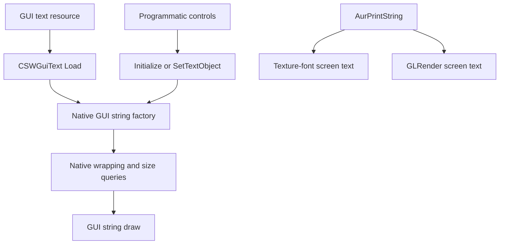

# Native text creation, layout and live coverage

Audit reference, 2026-10-17. Follows the [documentation standard](documentation-standard.md).
This extends the [GUI text inventory](text-layout-inventory.md) with native paths
and a read-only runtime census. It does not implement text fitting or modify the
executable or installed patch binaries. Separate copied test saves and a
diagnostic notification script are described below. Static paths, observed
objects and untested screens are kept separate.

## Build and method

Static code was read from clean CD K1 1.03, 4,042,752 bytes, SHA-256
`761f9466f456a83909036baebb5c43167d722387be66e54617ba20a8c49e9886`.
Addresses are preferred **VA**; **FILE = VA - 0x400000** for the clean sections
used here. No appended-section addresses or patches are introduced.

Local `addresses.db` supplied candidate names and class sizes, not authoritative
ABI proof. The code and live pointers were checked. The database contains 9,849
function entries. One class-size placeholder was found and corrected for bounded
inspection as described below; the database itself was not changed.

The live sample is the separate test game with KMRP module SHA-256
`f0dc43b4e06b9295eeb4ee959e859d8a016a80708f968a7b3477087f3c59f319`.
Matching module/map files are required to decode its private tracking maps.
Snapshot results identify the captured screen states, not all objects that can ever
exist or all strings visible simultaneously.

### Readable-memory boundary

A later focused probe localized the persistent scan failure in this process to
one 4,096-byte region, `0x06B39000..0x06B39FFF`. Windows reported committed private
memory with protection `0x202` (`PAGE_READONLY | PAGE_NOCACHE`). Full-page,
64-byte, four-byte and one-byte reads all failed with error 299 and zero returned
bytes, including retries; adjacent regions were free/inaccessible. Smaller reads
cannot close this particular gap. Its owner and contents remain unknown, so it
cannot be counted as empty or assumed not to contain text objects.

This probe is saved in `build/text-layout-inventory/heap-read-gap/`. It establishes
the current gap's size, not the addresses/sizes of every earlier historical read
failure. The collector now records failed addresses, byte counts and protection
alongside the failure count in future captures. Known rooted text objects and
readable scanned shapes can be reconciled without claiming complete process
memory or lifetime coverage. No page protections were changed to obtain access.

## 1. Native creation paths

[The static audit tool](../tools/audit_native_text_paths.py) scans executable PE
sections for direct relative calls/jumps to the selected text entry points. All
26 found references decode as the expected instruction when disassembled from
the nearest known database function entry. That verifies instruction alignment;
it does not independently recover function boundaries or cover every indirect
call. The output records all sites and 14 relevant virtual-table slots.

### Shared GUI-string factory

| Path | Call VA | FILE | Target | Meaning established from code |
| --- | --- | --- | --- | --- |
| Text resource load | 0x00416214 | 0x00016214 | 0x0045BDF0 | `CSWGuiText::Load` creates the native string after reading text parameters |
| Programmatic initialize | 0x0041734D | 0x0001734D | 0x0045BDF0 | `CSWGuiText::Initialize` creates/replaces the native string |
| Lazy text-object binding | 0x00415FAB | 0x00015FAB | 0x0045BDF0 | `CSWGuiTextParams::SetTextObject` creates a string if the wrapper lacks one |
| Factory construction | 0x0045BE4B | 0x0005BE4B | 0x0045B990 | Factory allocates 0x48 bytes and calls `CAurGUIStringInternal` constructor |

The common factory covers these three creation paths in the inspected native
executable. This does not prove an arbitrary injected DLL cannot create another
kind of renderer or bypass the factory.

The text loader also has a real fallback font: at VA `0x00416094` / FILE
`0x00016094` it loads the resource name `dialogfont16x16`, then reads `FONT` at
VA `0x004160C0` / FILE `0x000160C0` before setting the base font. A missing `FONT`
field can therefore be valid input for this loader. The updated file inventory
now includes `TEXT` structures even when `FONT` is absent and marks their font
source as unresolved/default-or-inherited. An independent baseline traversal found
**zero** missing or empty FONT fields among the current 2,071 definitions. That
closes this specific gap for the supplied corpus, not for future/modded resources.

### Text embedded in different native classes

There are eight direct calls to `CSWGuiText::Constructor` at VA `0x00417280`.
The receiver address is derived from the preceding native instructions. Six are
constructor functions; two are inlined button construction in population routines.
They are not eight unrelated layout policies.

| Native construction context | Call VA | FILE | Text wrapper relative to outer object | Verification |
| --- | --- | --- | --- | --- |
| `CSWGuiEditText` | 0x004173EE | 0x000173EE | +0x0, inherited base | Constructor passes its own receiver to the text base |
| `CSWGuiLabel` | 0x0041AD13 | 0x0001AD13 | +0xD0 | `lea ecx,[esi+0xD0]` |
| `CSWGuiButton` | 0x0041C143 | 0x0001C143 | +0x154 | `lea ecx,[esi+0x154]` |
| Main-menu module row | 0x0067C1C5 | 0x0027C1C5 | +0x154 | Inlined button construction; button vtable and member construction precede call |
| `CSWGuiStoreItemEntry` | 0x006B7246 | 0x002B7246 | +0x324 | Additional specialized text member |
| `CSWGuiInGameItemEntry` | 0x006B7F46 | 0x002B7F46 | +0x324 | Additional specialized text member |
| `CSWUpgradeItemEntry` | 0x006C3E66 | 0x002C3E66 | +0x334 | Different additional text-member offset |
| Movies row | 0x006DD572 | 0x002DD572 | +0x154 | Inlined button construction in `PopulateMovies` |

The row-specific text members show why fitting only a base button's text field
would be incomplete. Derived classes may contain several wrappers; a template's
single TEXT block does not by itself identify the member that draws an item name.
Edit fields also need a separate contract for caret movement, selection and
horizontal scrolling rather than shrinking on every new character.

## 2. Common layout and drawing paths



The diagram summarizes inspected paths; it is not a dynamic event trace.

| Operation | VA | FILE / virtual slot | Verified behavior |
| --- | --- | --- | --- |
| Wrapper extent change | 0x00416280 | 0x00016280 | Sends position/size to native string, then calls wrapper wrap |
| Wrapper wrap | 0x00414E90 | 0x00014E90 | Calls string vtable +0x4C |
| String wrap | 0x0045A2F0 | vtable 0x00741878 +0x4C, FILE 0x003418C4 | Computes lines using font metrics and local scale +0x40 |
| Wrapper draw | 0x00416240 | 0x00016240 | Dispatches through string vtable +0x7C with opacity |
| String draw | 0x0045A850 | vtable +0x7C, FILE 0x003418F4 | Uses fractional font height and local scale for positioning and glyphs |
| Ideal pixel height | 0x0045B7A0 | vtable +0x50, FILE 0x003418C8 | Includes local scale; returns rounded integer height; explicit-width path has additional rounding |
| Font pixel height | 0x00459610 | vtable +0x48, FILE 0x003418C0 | Reads font height, multiplies by 100, adds 0.5, converts; does **not** apply local scale |

The factory/constructor, wrapped-line arrays, local scale and rectangle offsets
are supported by native code and checked live wrapper/internal pointers. The live
census never calls game methods; it reads those fields only.

### Measurement correction relevant to a universal fix

The earlier proposal correctly identified per-string scale as a way to keep
shared font data unchanged. It was incomplete about the measurements that must
be adapted: `GetFontPixelHeight` ignores that scale, while ideal height and draw
use it. Applying a local cap without auditing consumers of both height APIs could
leave row/popup geometry inconsistent. These APIs have different contracts; this
is not authorization to change every caller to a scaled-height interpretation.

The confirmed title also exposes a rounding problem. At 97% its fractional
height is 46.56 px; at 98% it is 47.04 px. Both return **47** after the ordinary
round-to-nearest conversion, yet the 47-pixel box fits the first and loses the
line in the second. A fit check using only the rounded ideal height would miss
this exact cutoff. Fitting needs the draw-compatible fractional bounds or a
conservative ceiling, plus verification after the engine's rounding steps.
This is a requirement for the proposed fix, not a fix already applied.

### List layout already has separate native modes

The list's own layout contract also matters. Code at VA `0x0041B1A3` / FILE
`0x0001B1A3` tests flag 0x100 and dispatches to `OrganizeUnequal` at VA
`0x0041B1AA` / FILE `0x0001B1AA` when set. Otherwise it reads cached row height at
list +0x2B4, uses padding at +0x2C0, and derives visible count from the viewport.
`AddControls` stores row ownership (`row+0x34 = list`) at VA `0x0041C241` / FILE
`0x0001C241`; it sets the 0x100 mode from its argument and calls layout.

The census records those raw list fields. A future row fix should use and verify
the appropriate native mode and row measurement contract rather than multiplying
one global row height for every list. Neither mode has been changed by this audit.

## 3. Text drawn outside GUI-control boxes

The direct-reference audit identifies a separate screen-print path:

| Call path | Call VA | FILE | Target |
| --- | --- | --- | --- |
| Texture-font screen print | 0x0044CE0D | 0x0004CE0D | `CAurFont::TextOutA`, 0x004A1770 |
| Texture-font recursion | 0x004A1B27 | 0x000A1B27 | `CAurFont::TextOutA` |
| `AurPrintString` texture branch | 0x0044CFC6 | 0x0004CFC6 | `PrintStringScreenPos_UseTextureFont`, 0x0044CCA0 |
| `AurPrintString` GL branch | 0x0044CFF1 | 0x0004CFF1 | `GLRender::PrintStringAtScreenPos`, 0x0044CB90 |
| Main-loop screen print | 0x00404886 | 0x00004886 | `AurPrintString`, 0x0044CE50 |
| Posted-string screen print | 0x0044D164 | 0x0004D164 | `AurPrintString` |

These calls are statically reachable but were not event-traced in this session.
They must remain a distinct coverage family: there may be no `CSWGuiControl`
content rectangle to fit. A universal GUI-box cap must not silently invent a
box or apply a fixed-caption policy to screen overlays.

### Transient registries and repeatable observation

Transient HUD labels and raw posted screen strings are different native families.
The later audit found their private registries and added a separate
[passive sampler](../tools/audit_transient_text.py). It reads at requested
20-to-50-millisecond intervals, checks container consistency before/after object
reads, records timing gaps and object observation epochs, and exports metadata
without string contents. Polling is not an allocation or draw-event trace.

| Mechanism | Native VA | FILE | Verified relationship |
| --- | --- | --- | --- |
| Allocate posted screen string | 0x0044D4A6 | 0x0004D4A6 | Allocation 0x434 bytes, inline text rather than a GUI string |
| Posted registry access / count | 0x0044D41C / 0x0044D425 | 0x0004D41C / 0x0004D425 | Global array at 0x007B90FC, pointer/count/capacity |
| Posted render iteration | 0x0044D6C0 | 0x0004D6C0 | Calls `PostedString::Post`, which calls `AurPrintString` |
| Allocate floating HUD label | 0x0068B7D9 | 0x0028B7D9 | Allocation 0x154 bytes, label-derived vtable 0x00753EA8 |
| Floating-label registry append | 0x0068B93A / 0x0068B940 | 0x0028B93A / 0x0028B940 | MainInterface private array at +0x5CB4 |
| MainInterface global assignment | 0x0068C4D8 | 0x0028C4D8 | Global owner pointer at 0x00833BB4 |
| Floating-label draw loop | 0x0068B6F0 / 0x0068B700 | 0x0028B6F0 / 0x0028B700 | Iterates that array and calls each label's virtual draw |
| Console `whereami` posts | 0x0060B10C / 0x0060B159 | 0x0020B10C / 0x0020B159 | Two one-shot 10-second strings, grid positions (3,3) and (3,4) |
| Floating-text VM handler | 0x00535DB0 | 0x00135DB0 | Actions 525/526 build native feedback messages; string action is 526 |
| Script `AurPostString` handler | 0x005CB350 | 0x001CB350 | Stub consumes arguments without calling native `AurPostString` |

The floating label has a normal text wrapper at +0xD0, remaining/initial duration
at +0x140/+0x144, target object ID at +0x148, and base font `fnt_d16x16`.
The main census now follows the private array as well as ordinary controls.
The posted object instead stores text inline through +0x3FF, character count at
+0x400, remaining/initial duration at +0x404/+0x408, and grid coordinates at
+0x42C/+0x430. It has no verified GUI content rectangle or `CSWGuiText` wrapper.
Exact instruction guards and input hashes are saved by the sampler.

There is a separate fractional-height risk in the native floating-label builder.
At VA 0x00688EE0 / FILE 0x00288EE0 it sets width 200; at VA 0x00688EE7 /
FILE 0x00288EE7 it calls the wrapper font-height query (0x00414EE0), then stores
that integer as control height at VA 0x00688EFA / FILE 0x00288EFA. The query calls
the internal rounded font-height virtual +0x48 at VA 0x00414EEC / FILE 0x00014EEC.
Initialization selects centered alignment 0x12. At the current 47.04-pixel font
height, this construction predicts a 47-pixel box and the same fractional skip
condition as the title. This is a static prediction for a newly created combat
label at that stage of the audit. The subsequent confirmed combat capture below
measured that exact 47-pixel/47.04-pixel mismatch in live objects. Even a
dynamically calculated integer height is not necessarily a safe fractional draw
bound.

The idle smoke run captured 40 samples in one second with zero warnings and
both registries empty. That validates reading the registries while idle; it does
not count as observing an overlay. `whereami` can exercise the native posted path.
The similarly named script `AurPostString` action was rejected because its handler
is a stub. Triggered captures remain pending until their named results are
recorded here.

**Trigger correction:** the first diagnostic fixture used real action 526,
`FloatingTextStringOnCreature`, based on the expectation that its name implied a
floating on-screen label. The native message consumer instead routes subtype
0x5E through `AddFeedbackMessage` into `AppendToMsgBuffer`, call VA 0x0060224C /
FILE 0x0020224C targeting 0x0062B5C0. The inspected branch does not call the private
floating-label array or bark-bubble renderer. The first 60-second sample found
zero objects in both sampled registries; a later 90-second repeat also found zero,
with 16 read warnings during a module transition. Neither is a successful overlay
capture or proof that the bench script failed. The trigger expectation was wrong.
The user subsequently clarified that the screenshot showed the workbench target
banner and requested the existing Steam XP test save. Exact consumer switch-table
evidence is retained in `overlay-paths/floatingtext-action526-route.json`.

The raw renderer also has a different **font** contract. The normal first usable
screen print sets the texture selector to zero at VA 0x0044CF62 / FILE 0x0004CF62
and initializes embedded bitmap glyphs through 0x0044CB10 / FILE 0x0004CB10.
The bitmap covers ASCII 32 through 126, uses 8 x 13 pixel glyphs and a 10-pixel
horizontal advance. `AurPrintString` derives columns as `floor(viewportWidth/10)`
and rows as `floor(viewportHeight/14)`, then shifts/clamps the grid position by
character count. It does not wrap text into a GUI rectangle; strings longer than
the available columns can still extend beyond the viewport after x is clamped
to zero. The fallback dispatches raw bytes as GL display lists; no interpreted
newline handler was identified in that path.

This bitmap is embedded in the executable, not a resource such as `fnt_console`.
The current font preferences cannot resize it. A dormant texture branch at
0x0044CCA0 / FILE 0x0004CCA0 uses a separate `CAurFont` array at 0x0083052C
and index at 0x0078E358. No assignment tying that branch to `fnt_console` was
established. Static guards/import checks and idle selector values are saved in
`build/text-layout-inventory/overlay-paths/raw-screen-font-contract.json`.
If raw debug screen text is later exposed to size preferences, it requires a
separate viewport/grid adapter. GUI font fitting must not assume it already
shares the native GUI string renderer.

### Confirmed console and coordinate sample

The earlier empty `live-posted-whereami` capture did not establish a successful
console trigger. Discord intercepted the attempted shortcut; after Discord was
closed, switching the already installed keyboard layout to English (US) and
pressing the physical key below Esc opened the console. The user then confirmed
that `whereami` displayed coordinate text.

`live-posted-whereami-confirmed` recorded 3,600 samples over 90 seconds, zero
read warnings and a peak of four posted objects. Both expected 10-second
coordinate objects were present from sample time 18.2256 seconds through the
final sample at 89.9752 seconds: grid (3,3), 17 characters, and grid (3,4),
31 characters. Both had 7.35019 seconds remaining at the end. This confirms
positive registration and decreasing timers, but **not normal expiry or cleanup**;
the remaining duration did not reach zero in the capture. Console prompt objects
also use this registry. Their churn produced 1,086 observed pointer epochs;
these are not allocation identities or a count of coordinate messages.

Every sampled renderer state had initialized=true, texture-branch-selected=false
and texture-font-index=-1. Together with the guarded native branch evidence,
this corroborates the embedded-bitmap route while the user reported visible
coordinates. It is not a traced draw call. Exact metadata is retained in that
capture's `coordinate-summary.json`, `samples.json`, `observed-epochs.json`
and hash-bearing `manifest.json`; no string contents were exported. Combat
floaties remained absent, as expected for this trigger. Other resolutions,
long/raw strings and normal coordinate expiry remain untested.

### Confirmed combat interval, top banner and floating labels

The first two 90-second combat captures (`live-combat-floaties` and
`live-combat-floaties-ready`) had zero objects and zero read warnings. The user
subsequently confirmed combat and reported invisible floating text, but those
captures did not independently record combat state or prove trigger timing.
A later runtime read found floating-number option bit 0x10 enabled and the
private registry capacity had grown from zero to 16. A disabled option was
therefore rejected as an explanation for that snapshot; the earlier empty
recordings are not evidence that combat never creates native labels.

**Banner-state correction:** the first `live-combat-top-message` census found
an empty label, zero lines and message ID 48208. An initial interpretation treated
the ID as retained evidence of combat. The native constructor itself initializes
that ID and clears the label. The verified actual combat-mode getter returned
zero in the subsequent snapshot. That idle state cannot establish that message
content was lost during a fight. The passive sampler now has an opt-in
`--combat-banner` mode to record the actual mode and message together.

| Native contract | VA | FILE | Meaning |
| --- | --- | --- | --- |
| `CClientExoApp::GetCombatMode` | 0x005EDE70 | 0x001EDE70 | Wrapper +4 gives internal; internal +0x320 is the actual mode |
| Default combat message ID | 0x0068CFC9 | 0x0028CFC9 | Constructor sets MainInterface +0x7728 to 48208 before combat |
| Constructor clears top-label text | 0x0068D1B6 | 0x0028D1B6 | Calls `CSWGuiTextParams::SetText` on MainInterface +0x7444 |
| Runtime message ID assignment | 0x006877F5 | 0x002877F5 | `SetCombatMessage` stores the requested ID at +0x7728 |
| Native vertical draw-bound check | 0x0045ACAC through 0x0045ACE8 | 0x0005ACAC through 0x0005ACE8 | Compares the lower text bound with current vertical draw position and can end the remaining lines |

The user reloaded `TEXT AUDIT - Combat` and paused. A subsequent UI reply
indicated a fight and at least 30 seconds of active game time, but the later
paused-state clarification above limits how that reply can be interpreted. The
positive native object/mode measurements stand independently of that reply. The final
`live-combat-banner-and-floaties` capture contains **4,800 samples over 120 seconds,
zero read warnings and a peak of six private floating labels**. Actual combat
mode was one for 201 samples, from 29.1256 through 34.1253 seconds. The PC HUD
was in use at 1920 x 1080 with the resource-font groups at 98%.

| Active surface | Live evidence | Layout implication |
| --- | --- | --- |
| Top `LBL_CMBTMODEMSG`, MainInterface +0x735C | All 201 combat samples: 59-character nonempty stored/rendered text, visible bit set, opacity 1, centered alignment 0x12, two lines, 828 x 90 box | 2 x 47.04000056 = 94.08000112 pixels, exceeding height by 4.08000112; centered offset -2.04000056 before the native line-skip/bound checks |
| Private `CSWGuiFloatyText` | 1,949 positive object observations, six distinct pointers and ten observed pointer epochs; 1,948 one-line observations and one zero-line construction observation, all with text present | Each content box was 200 x 47 with fractional line height 47.04000056. Completed one-line layouts exceed their integer height by 0.04000056 |
| Floating-label lifetime | Initial timers 1.5 or 3 seconds; every observed epoch later absent, final disappearance by sample time 45.7001 seconds | Creation, nonempty strings and removal positively observed; wall-clock lifetimes can exceed timer durations when game time pauses |
| Top banner after combat | Mode zero, visible bit cleared, 59-character text retained | Hidden retained text after combat is distinct from the overflow measured while visible |

These runtime values match the guarded native centered line-skip and vertical
bound conditions. The user reported the missing top banner. **Visual-evidence
correction:** after an earlier multiple-choice reply indicated a fight and no
floating text, the user clarified that the game was still paused and damage
numbers would appear once fighting. Floating text must therefore not be called
a visually confirmed failure. Native objects and their geometric mismatch were
measured, but their visible rendering remains unverified. The combat-mode flag
is not a pause flag; the sampler did not record simulation-pause state. The
investigation did not breakpoint-trace or record draw calls, and no live
screenshot tool was available. The earlier empty-label snapshot is superseded
for diagnosing the active banner: **text was present while the measured combat-mode flag was one**.
Pointer epochs are not allocation identities; pointer reuse was observed.
The one zero-line observation must not be classified as a completed layout.

Exact metadata, executable/module/tool hashes and guards are retained in
`manifest.json`, `samples.json`, `observed-epochs.json` and the derived
`combat-analysis.json` in that capture folder. Creation gates and runtime option
reads are in `overlay-paths/combat-gates/`: accepted types 0 through 6, a valid
MainInterface, floating-number option bit 0x10 and actor/party filters. A failed
target lookup alone does not prevent MainInterface from appending a label.

This supplies positive native-path examples for the banner and combat floaties.
It does not establish every combat scenario, font style, translation, resolution
or GUI override. Floating labels require draw-compatible integer height bounds
(such as a verified upward rounding of measured height), while a bounded HUD
banner needs its own reviewed fitting/expansion constraint. No game runtime fix
was made in this audit.

## 4. Live census and matching to the catalog

[The runtime census](../tools/audit_live_text.py) opens the game with only
`PROCESS_QUERY_INFORMATION | PROCESS_VM_READ`. It does not inject code, call
native methods, suspend the process, write memory, or export game strings.

It walks:

- GUI-manager panel and modal arrays, and KMRP's tracked panels.
- Panel controls, child controls, list rows and separately stored list prototypes.
- The manager's tooltip and its separately owned background label.
- Two fixed message-history label pools and the cinematic dialogue's nested panel.
- Recognized inline text wrappers within bounded class spans.

A wrapper must have a recognized text vtable, its own text-parameter back-pointer,
and a valid native string vtable if instantiated. The heap comparison independently
looks for native string and wrapper shapes in readable committed private memory;
unrooted matches remain candidates, not proof of active allocations. Text presence
is recorded as a boolean; actual text contents are not saved.

Catalog binding has separate statuses: exact tracked template, prototype-related,
row-related, runtime custom panel, manager-owned without GUI slot, and unmatched
review. A related prototype is not proof that its font or dimensions survived
native row construction. Font agreement does not establish fitting behavior;
the inventory comparison-scope correction below also shows why an additional
native text member cannot inherit the prototype name field's comparison.

### Menu / Text Size and Font snapshot

At 1920x1080, the final menu census found:

| Measurement | Result | Limit |
| --- | ---: | --- |
| Tracked panels | 11 | Includes registered/dormant panels, not 11 visible screens |
| Rooted objects walked | 95 | Known GUI roots/relationships at this moment |
| Rooted text wrappers / instantiated strings | 88 / 88 | Not a lifetime allocation count |
| Nonempty strings | 63 | Nonempty does not mean currently visible |
| Exact template bindings | 40 | Association, not fitting proof |
| Prototype-related / row-related | 7 / 2 | Further native layout review required |
| Runtime custom-page text wrappers | 16 | The page has 20 controls; four sliders have no text wrapper |
| Manager-owned text wrapper without GUI slot | 1 | Background label; empty text in this snapshot |
| Other wrappers needing source-slot review | 22 | Owners known; precise file identity/policy still unresolved |
| Unknown owner vtables / unsupported object spans | 0 / 0 | For this rooted snapshot only |
| Heap native-string shapes / wrapper shapes | 88 / 88 | All observed shapes matched rooted objects |
| Unrooted heap candidates | 0 | No remaining candidates in readable scanned memory |
| Readable private bytes scanned | 139,767,808 | One chunk could not be read; snapshot is not atomic |

This is stronger than counting file fields, but it is not proof of game-wide
completeness: the scan has an unreadable-memory gap, dormant/visible distinctions,
unopened-screen classes and no event history. Additional injected renderers can
also bypass these native classes. Raw counts refer to the named saved snapshot.

### Gaps found and closed in the collector

The first bounded control-tree pass found 79 wrappers; the heap comparison found
nine additional wrapper/string pairs. These were investigated rather than counted
as nine new visible boxes:

| Missing relationship | Added coverage | Evidence |
| --- | ---: | --- |
| List prototypes | 7 wrappers | Native list prototype pointer at +0x2CC, separately from displayed row array at +0x29C |
| Tutorial box base members | 1 wrapper | Database size was 1; constructor at 0x006AA124 calls message-box base and writes through +0x995 |
| Manager background label | 1 wrapper | Native manager +0x7C; lazy creation/use in `DrawPCBG`, independently of panel arrays |

The tutorial span is a **constructor-derived minimum 0x996**, not a full sizeof
claim. The custom text-page panel is identified by its private current pointer
and the local source's 0x64 allocation. These overrides are reported in the census
manifest. The database and game remain unchanged.

Saved intermediate counts remain local evidence; the final menu snapshot is
`build/text-layout-inventory/live-menu-audit/`. Its CSV records owner class,
wrapper offset, actual text rectangle, requested font, alignment, scale, line
count, source association and raw owner flags. The manifest and heap comparison
record remaining gaps and tool/input identities.

### Gameplay HUD, inventory, dialogue and editable-field snapshots

The user navigated each named screen at 1920x1080 with the enlarged font setting.
These are separate, non-atomic captures; counts must not be added together as
unique allocations. Saved metadata contains no item names, dialogue or save names.

| Capture folder under `build/text-layout-inventory/` | Rooted objects | Text wrappers / heap string shapes | Unrooted heap candidates | Readable private bytes |
| --- | ---: | ---: | ---: | ---: |
| `live-hud-complete` | 897 | 1,025 / 1,025 | 0 | 207,720,448 |
| `live-inventory` | 995 | 1,219 / 1,219 | 0 | 208,961,536 |
| `live-dialogue` | 905 | 1,025 / 1,025 | 0 | 209,338,368 |
| `live-save-name-verified` | 920 | 1,042 / 1,042 | 0 | 211,259,392 |

Each final capture had zero unknown owner vtables, unsupported object spans and
root-walk warnings. The independent wrapper-shape count also equalled the rooted
string count. Each scan had **one
unreadable chunk**, so zero unrooted candidates is confined to readable scanned
memory, not proof of complete process or lifetime coverage. Source-slot and
layout-policy review remain incomplete even when ownership is accounted for.

**Catalog-attribution correction:** validation initially attempted to require zero
font disagreements in every capture. Inventory correctly failed that check with
97 records: every +0x324 additional text member requested `fnt_d16x16b`, while the
collector incorrectly compared it to the item-name prototype's `dialogfont16x16`.
The 97 name members at +0x154 matched that prototype. These are different native
text members, not 97 broken fonts. The original capture remains unchanged. The
collector now explicitly marks additional members as related to the row but
outside the prototype text member's font-comparison scope. All other related
font comparisons across these four captures matched. This distinction must also
be preserved for the store/upgrade constructors' additional text members.

The HUD pass initially found 896 rooted strings and 129 unrooted candidates.
Bounded owner-field inspection and constructor disassembly identified the
missing relationships. These were added to the collector and the capture was
repeated rather than describing the candidates as visible HUD controls:

| Native ownership relationship | VA | FILE | Verified storage / effect |
| --- | --- | --- | --- |
| Message-history array allocation | 0x00626616 / 0x00626621 | 0x00226616 / 0x00226621 | 64 `CSWGuiLabelHilight` elements, stride 0x1B4; two arrays |
| First message array pointer | 0x0062663D | 0x0022663D | Stored at messages panel +0x764 |
| Second message array pointer | 0x006266F8 | 0x002266F8 | Stored at messages panel +0x768 |
| Nested dialogue panel construction | 0x006A8D92 / 0x006A8D9F | 0x002A8D92 / 0x002A8D9F | Calls `CSWGuiDialogTop` constructor and stores pointer at cinematic panel +0x1DFC |
| Save-name edit-box construction | 0x006CAED3 / 0x006CAED8 | 0x002CAED3 / 0x002CAED8 | Calls base edit-box constructor; assigns vtable 0x007575B0 missing from the database |
| Editable text subobject | 0x0041C6E8 / 0x0041C6F3 | 0x0001C6E8 / 0x0001C6F3 | Base edit box constructs `CSWGuiEditText` at +0xE0 |

The message arrays have a checked 64-element allocation cookie; every element's
vtable is checked before following it. All 128 captured pool labels had zero-size
text rectangles; 64 were populated. They are pooled message objects, not 128
visible labels. The nested dialogue panel supplied the remaining wrapper.
Its constructor embeds a native label at +0x64, explaining the text wrapper at
nested-panel +0x134. Generic panel metadata alone does not establish a fitting
policy for that inner label.

The initial save-name capture accounted for its text through the containing
panel but reported an unknown child vtable. The native constructor proves this is
`CSWGuiSaveGameEditBox`. Its embedded storage span is 0x160 bytes, from panel
+0x3F0 to the next member at +0x550, matching the database's size hint. The
collector checks the constructor call/vtable bytes and now attributes the wrapper
to `savename.gui / EDITBOX`, offset +0xE0. The database was not edited.

### Measured layout distinctions and overflow conditions

Font height comes from native font metadata, not the font object's header. The
draw routine calls its virtual +0x38 getter at VA 0x0045A8B4 / FILE 0x0005A8B4.
The captured getter chain is `0x0041EFA0 -> virtual +8 (0x004205C0) -> virtual +4
(0x00641DB0) -> texture +0x38`. Font-info +4 is normalized height. The collector
checks getter identities, reads this chain without calling it, and records
`draw_line_height_px = normalizedHeight * 100 * localScale`. Unsupported getter
contracts retain an explicit unreviewed status. All 1,025 dialogue-capture metrics
passed these checks. This height alone is not a full wrapped-text measurement.

| Surface / native text member | Actual content rectangle | Captured text / layout | Implication |
| --- | --- | --- | --- |
| HUD `mipc28x6.gui`, unnamed label +0xD0 | 828 x 90 | Two lines, centered (0x12); line height 47.04000056 | Block needs 94.08000112 px; centered offset -2.04000056 px matches the leading-line skip condition |
| Inventory item name, `CSWGuiInGameItemEntry` +0x154 | 654 x 76 | 97 item rows: 93 one-line, four two-line; centered (0x12) | Two-line names need 94.08000112 px; centered offset -9.04000056 px matches the same skip condition |
| Inventory extra row text, +0x324 | 32 x 28 | 41 populated, 56 empty; body-family font, alignment 0x22 | Separate text member and much smaller bounds; do not treat every row field as its item-name box |
| Inventory description row, native label +0xD0 | 674 x 1458 | 14 wrapped lines; list viewport 728 x 240 | A scrollable content row, not a caption to shrink into a 240-pixel viewport |
| Inventory title `LBL_INV` | 1464 x 47 | One centered line, alignment 0x11, height 47.04000056 | Offset -0.02000028 px also crosses the title skip boundary |
| Dialogue reply rows, native labels +0xD0 | 1808 x 47 each | Four one-line replies, top aligned (0x09); actual `fnt_d16x16b` | Body-family assignment is now live-verified; not the menu font family |
| Nested dialogue message wrapper +0x134 | 1824 x 139 | Two lines, bottom aligned (0x22), body-family font | Different alignment/available bounds from replies; not evidence for centered-caption fitting |
| Save-name edit box +0xE0 | 1108 x 57 | One centered line, `fnt_d16x16b`, height 47.04000056 | Editable-field ownership/font/bounds captured; caret/selection/long-input scrolling remain untested |

The HUD-associated panel had 125 wrappers: 76 exact template associations and 49
requiring precise source-slot review. This includes 46 wrappers inside its bounded
native panel span. Registration and nonempty text are not proof that each was
visible. The named HUD overflow candidate was populated during the HUD capture;
its font height was read during the inventory capture with the same geometry.
No specific visible HUD wording or event was exported, and the draw branch was
not breakpoint-traced. Thus the numeric overflow condition is established, while
the exact on-screen reported HUD message still needs identification.

Sampled inventory rows had native extents 746 x 84, while their text areas were
654 x 76. `LB_ITEMS` cached row height was 84,
viewport 756 x 643 and the unequal-height bit was off. The raw +0x2C0 byte was 19;
do not assume cached height plus this byte establishes actual row pitch for
every native branch. The description list cached 1458 with viewport 728 x 240.
In contrast, dialogue's reply list had the unequal-height bit on, viewport
1808 x 141, cached height 47 and three visible rows out of four. Its prototype
remained 528 x 19, demonstrating why prototype dimensions cannot substitute for
actual constructed row bounds. Scroll behavior and hit geometry were not tested.

These measurements corroborate the title's centered-line omission mechanism for
inventory names and a HUD label. They do not justify shrinking every row or body
text box. Fixed captions, row containers, scrollable content and editable fields
need separate reviewed adapters over shared font measurement.

### Merchant Buy rows and the missing amount

The later `live-store-buy` capture found 1,083 rooted text wrappers, matching all
1,083 independently scanned native-string and wrapper shapes. There were zero
unrooted candidates, unknown owner classes, unsupported spans, root-walk warnings
or applicable template-font disagreements; one private-memory chunk remained
unreadable. The user reported the row amounts were broken while this screen was
open. No runtime fitting change was made.

| Native store member | Measured Buy-screen content | Font / alignment | Result |
| --- | --- | --- | --- |
| Item names, row +0x154 | 629 x 76; 29 names, 27 one-line and two two-line | `dialogfont16x16b`, centered 0x12; 47.04000056 px line height | Two-line names require 94.08000112 px and cross the centered skip condition |
| Row amounts, row +0x324 | 32 x 28; nine populated one-line numeric fields, each one digit; 20 empty | `fnt_d16x16b`, bottom aligned 0x22; 47.04000056 px line height | Even one line exceeds the 28-pixel box by 19.04000056 px |
| Selected item's stock value, `LBL_STOCK_VALUE` | 238 x 48; one line | Menu font, centered 0x14 | Different field from the amount beside the icon; its height accommodates the captured line |
| Description content row | 688 x 423; nine lines; list viewport 742 x 528 | Body font, top aligned 0x09 | Scrollable-body contract, separate from name and amount |

The amount is a separate native `CSWGuiText`, not part of the button's name text.
Static `CSWGuiStoreItemEntry::SetExtent` sets its rectangle independently:

| Operation | Native VA | FILE | Clean instruction / meaning |
| --- | --- | --- | --- |
| Quantity box height | 0x006B532E | 0x002B532E | `mov dword ptr [esp+0x2C],0x13`, fixed native height 19 before resolution handling |
| Quantity text width selection | 0x006B531F / 0x006B5326 | 0x002B531F / 0x002B5326 | Measures string length, compares against two characters; width subsequently uses 21 or 42 |
| Quantity text extent receiver | 0x006B5356 / 0x006B5367 | 0x002B5356 / 0x002B5367 | `lea ecx,[esi+0x324]`, calls that text member's extent setter |
| Bottom-aligned block-height comparison | 0x0045A99E / 0x0045A9B2 | 0x0005A99E / 0x0005A9B2 | Selects vertical mode 0x20 and multiplies line count by fractional font height |
| Bottom-aligned leading-line omission | 0x0045A9D0..0x0045A9FC | 0x0005A9D0..0x0005A9FC | Advances over lines while block height exceeds the content height |
| Exit when all lines omitted | 0x0045AA2D / 0x0045AA30 | 0x0005AA2D / 0x0005AA30 | Same final skipped-line count test as the centered branch |

Thus this amount has the same broad bounds mismatch as the title, through a
**different alignment branch**: its one 47.04-pixel line does not fit a 28-pixel
box. The static branch conditions predict skipping its only line and agree with
the user's report. This is numeric live-state plus static control-flow evidence,
not a breakpoint trace of that draw call. Font texture absence is not needed to
explain the failure. `row-member-metadata.json` records lengths/numeric flags and
dimensions without saving the actual item names or amounts.

A shared row fix must account for both name and amount text, including width for
larger counts, icon placement and list-owned interaction geometry. Changing only
the name's text extent or the outer row height does not update the amount member.
This is a compact-counter subcase inside a selectable row, not a reason to apply
one undifferentiated scale to every text member.

The Buy item list had cached row height 84, viewport 743 x 657, unequal-height bit
off and seven visible rows. The inactive Sell list had zero constructed rows and
uninitialized-looking cache values, including a 1,329,149,519 cached height. Those
raw fields are **not valid measured Sell geometry**. The collector now marks
unpopulated list caches as unverified rather than treating their values as a
layout contract. Ownership/wrapper validity does not imply initialized layout
cache fields. The following Sell capture supplies the populated comparison.

`live-store-sell` matched 1,145 rooted wrapper/string pairs against the independent
heap shapes, with zero unrooted candidates, root warnings or applicable font
disagreements; one memory chunk was unreadable. It added 31 constructed rows in
`LB_INVITEMS`: each name area was 613 x 76, each amount area 32 x 28, and nine
amount fields were populated. All 31 names were one line in this sample. The Sell
list now had a valid-looking cached height 84, viewport 735 x 657, seven visible
rows and unequal-height mode off. Those geometry values describe this populated
snapshot, not the earlier uninitialized cache.

The old 29 Buy rows remained allocated after switching to Sell. Their nine amount
fields account for half of the 18 populated quantity wrappers in the combined
capture; they are not 18 visible Sell amounts. `row-layout-summary.json` in each
capture groups members by native list owner and prototype association, preserving
the distinction between `LB_SHOPITEMS` and `LB_INVITEMS`.

### Workbench item and component rows

`live-upgrade-list` captured four `CSWUpgradeItemEntry` rows in
`upgradeitems.gui`: three one-line names and one two-line name. Name text at
+0x154 had 643 x 76 content bounds; the additional +0x334 text had 32 x 28
bounds and was empty in all four rows. The item list used cached height 84,
viewport 764 x 727 and unequal-height mode off. Thus the two-line name crosses
the same 94.08-versus-76 centered-text boundary, but the empty additional fields
alone were not evidence of a visible counter failure.

`live-upgrade-components` then captured four component rows associated with
`upgrade.gui`, each with 628 x 76 name text and separate 32 x 28 +0x334 text.
One additional field was populated, bottom aligned 0x22, at the same
47.04000056-pixel font height. The native upgrade `SetItem` formats its quantity
with the same integer format as the store (`CExoString::Format` call at VA
0x006C4121 / FILE 0x002C4121). This supplies a populated upgrade counterpart to
the store's compact-counter case. A later attempt to inspect its character
count after the user changed screens was discarded; no character-count claim
for this upgrade field is derived from that later read.

The two captures respectively matched 1,078 and 1,086 rooted text wrappers
against all independently scanned native-string/wrapper shapes, with zero
unrooted candidates, unknown classes, unsupported spans, root warnings or
applicable template-font disagreements. Each had one unreadable memory chunk.
The captures include the registered `upgrade.gui`, `upgradeitems.gui` and
`upgradesel.gui` panels, not three simultaneously visible screens. Empty lists
in dormant panels retain their explicit unpopulated/unverified status.

These observations cover both the primary and additional text members of the
distinct native upgrade row class. They do not test assembling an item,
controller focus, all item categories, lightsaber-specific slot geometry or
font-size changes while scrolling.

### Container, target banner and adaptive XP/status popup

The user also left a container open in the copied XP save. `live-container-xp`
matched 1,035 rooted strings/wrappers against all readable scanned shapes, with
no root warnings. It captured five inventory-style item rows: three names had
two lines in 217 x 84 text areas, two had one line, and one +0x324 amount was
populated in its 32 x 28 box. At 47.04-pixel line height, the two-line names need
94.08 pixels. A two-line container button caption also exceeded its 345 x 56
area. These are additional shared row/caption cases, not new rendering engines.

The blank banner in the user's workbench screenshot was separately captured in
`live-blank-target-banner`. The populated native MainInterface text member at
+0x1758 had a 300 x 47 content area, one centered line and 47.04000056-pixel height.
Its centered offset is -0.02000028 pixels, the same fractional boundary as the
missing title. The banner is distinct from a notification or a scripted floating
label; the screenshot alone did not establish that a notification trigger ran.

The user's existing Steam save `XP Bug` was copied to the separate game's new
`TEXT AUDIT - XP Bug` slot. All gameplay save bytes remain identical; only the
copied display name changed. Source/destination hashes and undo are recorded in
`build/text-layout-inventory/xp-save-copy.json`. The user triggered XP and reported
the message appeared, then observed that it already resized dynamically.

That observation is supported by both source and live measurement. This XP popup
is `CSWGuiStatusSummary`, not either of the sampler's transient registries. Native
row 2 consumes the XP accumulator (+0x70), at VA 0x00625E93 / FILE 0x00225E93.
The popup appeared in both manager and modal arrays at the same address, and is
counted once. Existing `layoutStatusSummary` in
[K1ControllerLayout.cpp](../src/controller-native/K1ControllerLayout.cpp) measures
text width/font height, scales row/icon/button geometry from a 16-pixel reference,
limits width to the screen and recenters the box. The following active XP state
was measured; nonempty hidden descriptions in its other rows are not visible XP
messages:

| Element | Live bounds / metrics | Interpretation |
| --- | --- | --- |
| Popup | 1031 x 211 at (444,434) | Centered adaptive box |
| Active XP text `LBL_XP_DESC` | 849 x 94 at local (153,26); one line | Ample height for 47.04000056-pixel line |
| XP icon | 94 x 94 | Scaled with the active row |
| OK text | 294 x 71 | Distinct caption area, also accommodates this one line |

The source formula predicts these values using rounded line height 47:
`at16(v) = (v*47+8)/16` with integer division, so a 32-unit row becomes 94 pixels
and its 52-unit text offset becomes 153. This closes the numeric loop on the
existing adapter. `live-xp-summary` matched all 1,035 rooted string/wrapper shapes,
with zero root warnings and the exact 4,096-byte unreadable range recorded.
The 90-second `live-xp-notification` sample found zero entries in the private
floaty/posted registries with zero warnings; that is expected for this different
popup class, not evidence that the reported XP popup was absent.

This is a verified existing adaptive case to preserve. It is not a complete
extreme-case guarantee: the width helper reads at most 256 bytes, does not include
per-string local scale, and does not establish general multiline or screen-height
fitting. The installed test setup includes the controller module; this audit does
not establish behavior with that module absent merely because mouse input works.

## 5. Remaining screen coverage

### Scope of the extended pass

The user requested store/upgrade and transient checks, then clarified that no
additional mods are to be included. The named test installation contains KMRP,
KMRP Controller Support and Party Roster Limit 32. Their module hashes are recorded
in `build/text-layout-inventory/current-audit-mod-scope.json`, together with the
pre-fixture Override inventory: no loose `.gui` files, one roster departure
script and five test companion templates. There is no separate supplied mod-GUI
corpus to validate in this pass. This is a scope decision, not a universal
compatibility claim about future renderers.

The pre-extension captures associated **409 distinct exact source slots across
33 GUI files** with live objects, after deduplicating `(gui,catalog_path)`.
Prototype-related rows and runtime-only members are deliberately excluded from
that count. `build/text-layout-inventory/source-binding-coverage.json` records
the input capture names. The full file catalog contains 2,071 definitions;
409 runtime associations do not establish visual/behavioral correctness of
those slots or live coverage of all 2,071 definitions. Native mechanism coverage,
definition inventory and per-screen behavioral testing remain separate claims.

### Isolated native test saves

The user needed saves near the relevant interfaces. Five new save folders were
created only in the separate test game; original saves and patch binaries were
preserved. The merchant and workbench saves use existing native objects and
locations, without position edits or replacement scripts. Only their copied
`SAVEGAMENAME` values changed. Measured distances to the native target are
4.87 and 4.50 world units, respectively.

| Copied display name | Native target / controlled change | Evidence boundary |
| --- | --- | --- |
| `TEXT AUDIT - Merchant` | Crattis Yurkal, `dan13_crattis`, module `danm13` | Buy and Sell row/amount captures recorded above |
| `TEXT AUDIT - Workbench` | `repairtable2`, native `k_pdan_bench01` calls `ShowUpgradeScreen` | Item-list and component-row captures recorded above |
| `TEXT AUDIT - Notifications` | Same copied bench; this save alone changes its `OnUsed` to diagnostic `kmrptxtprobe` | Rejected popup trigger: action 526 routes to message history; original fixture retained for traceability |
| `TEXT AUDIT - XP Bug` | Copy of the user's existing Steam `XP Bug` save | Container and active adaptive XP/status popup captured |
| `TEXT AUDIT - Combat` | Unmodified copied Endar Spire save near two live hostile Sith soldiers | Native combat-mode interval and private floating labels captured, including removal; floating-text visibility remains unverified |

The original notification fixture adds a new `Override/kmrptxtprobe.ncs`, rather than
replacing an existing script. It pushes engine arguments in the verified native
right-to-left order and calls `FloatingTextStringOnCreature` on `GetFirstPC`,
with broadcast disabled. Its popup expectation was subsequently rejected as
recorded above; the action writes to message history in this engine. It
deliberately omits the stub script `AurPostString`
action. Its NCS parses successfully; read-back checks preserve every other
module resource and every other outer save resource byte-for-byte. The copied
source save's files remain unchanged. Hashes, exact output paths and removal
instructions are recorded in `native-test-saves.json` and
`notification-fixture.json` under the ignored audit output folder. These are
test fixtures, not a shipped font/layout behavior change.

| Surface | Static paths / owners | Live sample | Next evidence |
| --- | --- | --- | --- |
| Menus and new text options | Shared factory/wrapper classes identified | Captured; 88 rooted strings accounted for | Visibility and fitting policies remain separate review |
| Native list prototypes | Identified and included in traversal | Captured in menu lists | Other native row classes still need gameplay sample |
| Gameplay HUD | Label/button/adaptive layout sources identified | 125 HUD-associated wrappers; blank target banner measured separately | Other HUD variants and policy review; top combat banner and floaties now sampled separately |
| Inventory/store/upgrade | Specialized text members identified (+0x324/+0x334) | Inventory 97 rows; merchant Buy 29 / Sell 31; upgrade four items / four components, primary and additional fields | Changing row size, scrolling/hit geometry, all item categories and lightsaber slot variants |
| Conversation and replies | Source templates and common string paths identified | Four reply rows, body-family font, nested dialogue panel and list geometry | Multiline replies, other dialogue variants, scroll and focus behavior |
| Editable text | Edit-text creation path identified | Save-name edit box captured; constructor-verified class | Caret, selection, horizontal scrolling and long-input behavior |
| XP/status popup | Existing font-derived row/icon/button adapter | User-triggered XP, active 849 x 94 text area for a 47.04-pixel line | Long/multiline cases, screen-height limits and local-scale measurement contract |
| Combat floating labels | Native private array and label/font-height construction identified | Positive native capture: peak six labels; ten pointer epochs with later removal; 47-pixel boxes versus 47.04-pixel lines. Visual failure unverified | Draw-compatible rounding/fitting and behavioral validation across font styles, sizes and combat cases |
| Screen overlays / posted strings | Separate embedded-bitmap/grid path verified statically | User-confirmed `whereami`; both 10-second coordinate objects at (3,3)/(3,4), bitmap selector active | Normal expiry/cleanup, other resolutions and long strings; separate from current resource-font preferences |
| Additional modded GUI/DLL renderer | Current installed-module scope inventoried | No additional mods supplied/requested | Outside this pass; no universal future-mod claim |

The native paths and census now make these gaps explicit and repeatable. A small
set of fitting policies can be designed against real owner classes; this audit
does not yet mark those policies implemented or all surfaces verified.

The expanded capture set now has **447 distinct exact source-slot associations
across 36 GUI files**, recorded in `extended-audit-verification.json`. This count
still excludes prototype-related and runtime-only members and remains distinct
from the 2,071-definition catalog and from visual/behavioral coverage.

### Additional PC pause-notice geometry

The user reported that the pause notice was too narrow and requested the same
width as the HUD menu-button row above it. The read-only `live-pause-width`
capture has 1,025 rooted text pairs and zero traversal warnings or unknown
classes/spans. No heap comparison was requested for this additional geometry
sample; it is not a twelfth heap-verified capture. The follow-up extent reads
use the native `{left,top,width,height}` at control +0x04 and are non-atomic with
the original census. Evidence is retained in `geometry-summary.json` and
`native-contract.json` in that capture folder.

| Live owner / surface | Measured bounds | Text / relationship |
| --- | --- | --- |
| `CSWGuiInGamePause`, `pause.gui` | (1616,67), 301 x 345 | Right edge 1917 on the 1920-wide test screen |
| Eight PC HUD menu buttons, `BTN_EQU` through `BTN_OPT` | Left 1323, right 1902, total span 579 | Each button 58 x 58; this is the user's requested width reference |
| `LBL_PAUSEREASON`, label at panel +0x64 | Local (15,11), 274 x 329 | Seven wrapped lines at 47.04000056 pixels; fractional total 329.28000391 exceeds integer height by 0.28000391 |
| `LBL_PRESS`, label at panel +0x1A4 | Local (15,59), 274 x 90 | Four retained wrapped lines; current visibility is not inferred from retained text |
| `BTN_UNPAUSE`, button at panel +0x2E4 | Local (15,11), 274 x 345 | Empty text; click area spans the message rather than a caption of its own |

Clean native `SetPauseReason` (VA 0x006C00C0, FILE 0x002C00C0) measures wrapped
heights, preserves existing widths, updates the panel height and its overlaid
unpause button. The verified height query is at VA 0x006C0185 / FILE 0x002C0185;
reason extent update at 0x006C01B7 / 0x002C01B7; panel and button updates at
0x006C0274 / 0x002C0274 and 0x006C0290 / 0x002C0290. The second label is
shown/hidden by the pause-reason branch; retained geometry alone cannot prove
it is visible. `SetupPauseGuiExtent` (VA 0x00688DB0, FILE 0x00288DB0) positions
that existing box below the HUD row and three pixels from the right edge; it
does not expand its width to the row. Static disassembly was not execution-traced.

This is an anchored container-layout case, rather than only a fixed caption.
The proposed adapter should read both outer edges of the actual PC HUD button
row, preserve live content insets, set available widths before native wrapping,
then derive height, placement and the unpause hit rectangle from the resulting
text. Fractional draw-compatible height bounds must be rounded up and checked.
Reflow also needs to respond to text/font changes while the pause screen is
already open. The separate Xbox HUD's existing `PauseNotice` layout must retain
its own anchor and controller prompt behavior. No adapter or runtime change was
implemented by this measurement. Other pause reasons, translations, resolutions,
Xbox switching and click behavior remain untested in this sample.

## 6. Reproduce

With the clean executable, local address database, matching KMRP map and Python
`capstone`/`pykotor` available:

```powershell
python tools/inventory_text_layout.py --all
python tools/audit_native_text_paths.py
python tools/audit_live_text.py --pid <game PID> --heap-scan --out build/text-layout-inventory/live-<screen>
python .github/scripts/check_links.py
```

The static audit refuses a noncanonical executable. The live tool checks sample
ABI sites, bounded container shapes, self/back-pointers and class vtables. Capture
while the named screen remains stable, review warnings and unreadable chunks, and
retain `manifest.json`, `text-objects.csv`, `object-tree.json`, and optional
`heap-comparison.json`. Do not compare counts across different screens as if they
were a single atomic allocation set. Match the loaded module and map before using
private tracking symbols. To promote a family from candidate status, record its
native class, effective bounds and interaction behavior in the main review ledger.
